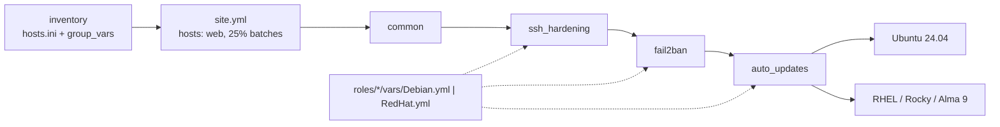

# Ansible Linux Hardening

Baseline OS hardening for a web-tier EC2 fleet running **Ubuntu 24.04** and **RHEL 9 (Rocky, Alma)**.
Every web server gets this before its application is installed.

## Problem

Web hosts are scanned within minutes of launch, and stock images allow password SSH and legacy ciphers,
with no brute-force throttling and no automatic patching. Hardening by hand leads to drift: servers
that should match end up different, and nobody can show an auditor what "hardened" means. This repo
turns the baseline into code that is reviewed once, applied the same way on both distros, and safe to
re-run.

## Architecture



```text
inventory ──▶ site.yml ──▶ common ─▶ ssh_hardening ─▶ fail2ban ─▶ auto_updates ──▶ Ubuntu 24.04
(group_vars)  (hosts: web)                 ▲                                    └─▶ RHEL 9
                             roles/*/vars/{Debian,RedHat}.yml
```

## Controls

Benchmarks targeted: **CIS Ubuntu Linux 24.04 LTS v1.0.0** and **CIS Red Hat Enterprise Linux 9
v2.0.0**. Only a subset is covered: the SSH server settings plus a few network and service items. I
have not checked section numbers against the benchmark PDFs, so each one is marked *verify*.

| Control | What it does | Role | Reference |
|---|---|---|---|
| `PermitRootLogin no`, `PermitEmptyPasswords no` | No root or blank-password logins | ssh_hardening | CIS SSH Server, verify § |
| `MaxAuthTries 4`, `LoginGraceTime 60` | Limits guessing per connection | ssh_hardening | CIS SSH Server, verify § |
| `ClientAliveInterval 300`, `ClientAliveCountMax 2` | Drops idle sessions after 10 min | ssh_hardening | CIS SSH Server, verify § |
| `X11Forwarding no`, `HostbasedAuthentication no`, `IgnoreRhosts yes`, `PermitUserEnvironment no` | Removes unused access paths | ssh_hardening | CIS SSH Server, verify § |
| Cipher, MAC and KEX allow-lists | Removes CBC and SHA-1 options | ssh_hardening | CIS SSH Server, verify § |
| `Banner /etc/issue.net`, `LogLevel VERBOSE` | Legal notice and key fingerprints in logs | ssh_hardening | CIS SSH Server, verify § |
| `PasswordAuthentication no` (opt-in) | Key-only login, with a lockout guard | ssh_hardening | Not CIS default here, see below |
| `sshd_config` owned by root with mode 0600 | Only root can read or change it | common | CIS SSH Server, verify § |
| Mask avahi, cups, rpcbind, vsftpd, telnet if installed | Fewer listening services | common | CIS Services, verify § |
| rp_filter, no ICMP redirects, SYN cookies | Spoofing and redirect protection | common | CIS Network Parameters, verify § |
| fail2ban sshd jail: 5 tries in 10 min = 1 h ban | Throttles brute force | fail2ban | Defense in depth, not CIS |
| Security updates applied daily, no automatic reboot | Patches without waiting on people | auto_updates | CIS Software Updates, verify § |

## Design decisions

| Decision | Alternative | Why |
|---|---|---|
| sshd settings in a drop-in, `sshd_config.d/00-baseline-hardening.conf` | Edit `sshd_config` in place | Package upgrades own `sshd_config`. sshd keeps the first value it reads, so `00-` beats `50-cloud-init.conf` and `50-redhat.conf`. |
| Two checks before restart: `validate: sshd -t` on the file, then an `sshd -t` handler before the restart handler | Restart and hope | A bad file never lands on disk, and sshd never restarts on a config that fails the check. |
| Password auth left on by default. Turning it off is opt-in, and the role first checks for an authorized key | Turn it off unconditionally | Turning it off before key login works is the classic lockout. When off, keyboard-interactive is off too, because PAM would still accept passwords. |
| One crypto list for both distros, in `group_vars/all.yml` | A list per distro | One policy to review. The algorithms are the ones OpenSSH 8.7 and 9.6 both support. |
| `serial: 25%` with `max_fail_percentage: 0` | All hosts at once | A bad SSH change stops after one batch. |
| Per-distro values in `vars/{Debian,RedHat}.yml`, loaded by `ansible_os_family` | `when:` conditions on tasks | Tasks are the same on both distros; only names and paths change. |
| fail2ban reads the systemd journal and bans with nftables | auth.log and iptables | The journal and nftables exist on both distros. RHEL has no auth.log. |
| Automatic reboots off | Reboot after kernel updates | The platform replaces instances on a schedule, so an unplanned reboot is avoidable downtime. |
| `host_key_checking = True` | Turn it off globally | Turning it off removes MITM protection. For new hosts, use `accept-new` per group. |

## Usage

```bash
pip install -r requirements-dev.txt
ansible-galaxy collection install -r requirements.yml
ansible-playbook site.yml --check --diff -l web-ubuntu-01   # dry run on one host
ansible-playbook site.yml                                   # whole fleet
```

## Testing

| Check | Status |
|---|---|
| `yamllint .`, `ansible-lint` (production profile), `ansible-playbook site.yml --syntax-check` | Pass, locally and in CI |
| `molecule test` on Ubuntu 24.04 and Rocky 9: converge, idempotence (`changed=0`), verify | Pass in CI |
| `--check` with `-i inventory/local.ini` | Not run: no Ubuntu or RHEL 9 machine was available |

Molecule runs as root without `sudo` (it is broken in the Rocky 9 test image) and uses fail2ban's
`dummy` ban action (the containers have no firewall). So the `sudo` path and real nftables banning are
not exercised by CI. The roles have not been run against a real EC2 host.

Verification checks what the host actually does, not what the tasks report:
- `sshd -T` values and the exact crypto lists
- the lockout guard refuses a user with no keys
- `fail2ban-client status sshd` succeeds
- the update package and its security-only, no-reboot config

## Limitations

- On RHEL itself (not Rocky or Alma), point `fail2ban_repo_packages` at the EPEL release RPM URL.
- The lockout guard only checks `~/.ssh/authorized_keys`. It does not see keys from `AuthorizedKeysCommand`, such as EC2 Instance Connect.
- Under a RHEL FIPS crypto policy, remove chacha20 and curve25519 from the lists.
- Not covered: firewall, auditd, file integrity monitoring.
